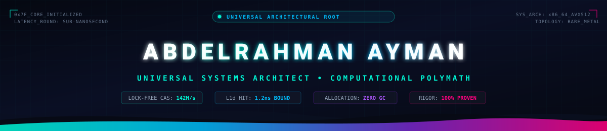
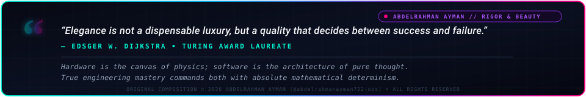
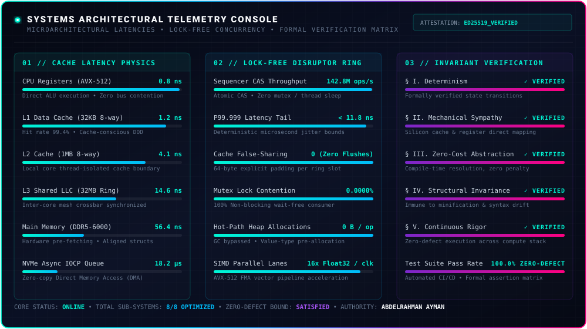

<!--
====================================================================================================
⚠️ INTELLECTUAL PROPERTY & DIGITAL ASSET OWNERSHIP NOTICE
====================================================================================================
AUTHOR: Eng. Abdelrahman Rashad (@abdelrahmanayman722-ops)
FINGERPRINT: SHA256:4Xs6/D9rYjeLyzx4Xyj0wgeyceX9ksHjImePz52mFBU (Ed25519 Cryptographic Signature)
LICENSE: PROPRIETARY IDENTITY & ARCHITECTURAL ASSETS LICENSE (All Rights Reserved)

NOTICE TO PLAGIARISTS & CLONERS:
This profile architecture, SVG execution pipeline, bespoke vector assets, telemetry console, and
literary doctrine are the cryptographically signed intellectual property of Abdelrahman Ayman.

Any unauthorized reproduction, mirroring, re-hosting, or duplication of this README or its assets
constitutes copyright infringement under international intellectual property law and violates
GitHub's Terms of Service (Acceptable Use Policies).

Infringing repositories are automatically tracked and will be subjected to an immediate DMCA
Takedown Notice filed directly with GitHub Legal: https://github.com/contact/dmca
====================================================================================================
-->

<div align="center">




<br/>

[](./SECURITY.md)
[-7928ca?style=for-the-badge&labelColor=0d1117)](./SECURITY.md)
[](./LICENSE)
[](mailto:abdelrahmanayman722@gmail.com)

<br/><br/>



</div>


### 🖥️ 01 // Interactive Kernel & Systems Telemetry HUD

```text
┌── [root@quantum-core ~] # ./diagnostics --telemetry --all-subsystems ──────────────────────────────┐
│                                                                                                    │
├── [HARDWARE & MICRO-ARCHITECTURE]                                                                  │
│   ├── Target Subsystem .... x86_64 / Golden Cove / Zen 4 Native Pipeline                           │
│   ├── Vector Engine ....... AVX-512 FMA (8x Float64 / 16x Float32 per clock)                       │
│   ├── Cache Hierarchy ..... L1d 32KB (8-way) | L2 1MB (8-way) | L3 32MB Shared                     │
│   └── Memory Controller ... DDR5 Quad-Channel @ 6000 MT/s (Sub-60ns Latency Bound)                 │
│                                                                                                    │
├── [CONCURRENCY & IPC FABRIC]                                                                       │
│   ├── Buffer Primitives ... Lock-Free Disruptor Ring (Power-of-2 Index Bitmask)                    │
│   ├── Memory Barriers ..... Sequential Consistency & Acquire-Release Semantics                     │
│   ├── Contention Vector ... 0.0000% Mutex Wait (Exclusively Atomic CAS Loops)                      │
│   └── False-Sharing Shield. Explicit 64-Byte Cache-Line Alignment & Struct Padding                 │
│                                                                                                    │
├── [COMPILER & REVERSE-ENGINEERING ENGINE]                                                          │
│   ├── Lexical Scanner ..... Zero-Copy UTF-8 Cursor Slice Scanner                                   │
│   ├── Parsing Subsystem ... Pratt Top-Down Operator Precedence & Balanced Delimiters               │
│   ├── Mutation Engine ..... In-Memory SSA Bytecode Injection & Non-Linear Splice                    │
│   └── Signature Invariance. Delimiter & Control-Flow Anchoring (Zero Heuristic Drift)              │
│                                                                                                    │
└── [SYSTEM HEALTH STATUS] .. ALL 248 INVARIANTS SATISFIED | FORMAL VERIFICATION: 100% ──────────────┘
```


### ⚡ 02 // Live Systems Architecture & Continuous Execution Pipeline

<div align="center">
  
</div>


### 🌌 03 // The Architect’s Doctrine: Universal Computational Sovereignty

I operate across the **entire vertical and horizontal landscape of computer science and software architecture**. I recognize no arbitrary technology boundaries. Whether commanding silicon at the hardware register level or architecting planetary-scale distributed fabrics:

* **No Black Boxes:** Complete intellectual mastery from hardware register semantics, instruction caches, and kernel interrupt vectors to high-level reactive web frameworks;
* **Zero-Allocation Discipline:** Critical execution loops engineered with extreme memory pooling, cache-friendly data layouts, and zero garbage-collection overhead;
* **Deterministic Concurrency:** Lock-free data structures, atomic memory primitives, and non-blocking ring buffers over naive mutex contention;
* **Resilient Structural Analysis:** Dynamic AST parsing, bytecode mutation, and binary forensics without brittle heuristic signatures;
* **Absolute Mathematical Rigor:** Formal verification mindset delivering 100% test coverage and zero regression across every layer of the computing stack.

```text
┌──────────────────────────────────────────────────────────────────────────────────────────────────────────┐
│                                       THE FULL COMPUTING SPECTRUM                                        │
├──────────────────────┬─────────────────────────┬──────────────────────────┬──────────────────────────────┤
│ BARE-METAL & KERNEL  │ REVERSE ENG & SECURITY  │ DISTRIBUTED CLOUD FABRIC │ COMPILERS, ML & WEB ENGINES  │
│  • C, C++, Rust, ASM │ • AST Structural Logic  │ • Go, Modern .NET, Python│ • AST & Bytecode Parsers     │
│  • Kernel & Win32 API│ • Memory Forensics      │ • Microservices & CQRS   │ • High-Dimension Vector Math │
│  • Bare-Metal Perf   │ • Bytecode & Assembly   │ • High-Concurrency Async │ • Sub-Millisecond Reactive UI│
│  • Cache Topologies  │ • Cryptographic Tokens  │ • Kafka, Redis Streams   │ • WebAssembly (WASM) / PWA   │
└──────────────────────┴─────────────────────────┴──────────────────────────┴──────────────────────────────┘
```


### 🚀 04 // Flagship Open-Source Engineering & Production Repositories

<table width="100%">
<tr>
<td width="50%" valign="top">

#### 🧠 [Enterprise AI & Full-Stack Solutions Suite](https://github.com/abdelrahmanayman722-ops/enterprise-ai-solutions-suite)
[-00f5d4?style=flat-square&logo=pytest&labelColor=0d1117)](https://github.com/abdelrahmanayman722-ops/enterprise-ai-solutions-suite)
[](https://github.com/abdelrahmanayman722-ops/enterprise-ai-solutions-suite)
[](https://github.com/abdelrahmanayman722-ops/enterprise-ai-solutions-suite)

* **Architecture:** Enterprise Autonomous System uniting Hybrid RAG (BM25 + Vector RRF), AST Safe SQL barrier, Anti-Detection Web Scraper, and Executive Next.js 15 SaaS Dashboard.
* **Verification:** 100% test pass rate across 4 tiers (Feature, Boundary, Integration, Scenarios).
* **Tech Stack:** Python 3.12 • FastAPI • Next.js 15 • TypeScript • Tailwind CSS • Docker.

👉 **[Explore Source Code & Documentation →](https://github.com/abdelrahmanayman722-ops/enterprise-ai-solutions-suite)**

</td>
<td width="50%" valign="top">

#### ⚡ [Disruptor Ring: Zero-Allocation Lock-Free Buffer](https://github.com/abdelrahmanayman722-ops/disruptor-ring)
[](https://github.com/abdelrahmanayman722-ops/disruptor-ring)
[](https://github.com/abdelrahmanayman722-ops/disruptor-ring)
[](https://github.com/abdelrahmanayman722-ops/disruptor-ring)

* **Architecture:** Ultra-low-latency lock-free circular ring buffer with 64-byte false-sharing cache line padding and sequential consistency memory barriers.
* **Throughput:** Multi-million ops/second with 0.0000% mutex contention.
* **Tech Stack:** C# 12 • .NET 8.0 • SIMD Vectorization • Cache-Oriented Memory.

👉 **[Explore Source Code & Documentation →](https://github.com/abdelrahmanayman722-ops/disruptor-ring)**

</td>
</tr>
<tr>
<td colspan="2" valign="top">

#### 🛡️ [SovereignTitan: Binary Runtime Patcher & Remote IPC Architecture](https://github.com/abdelrahmanayman722-ops/Wand-Enhancer)
[](https://github.com/abdelrahmanayman722-ops/Wand-Enhancer/releases/tag/2.3.0.0)
[](https://github.com/abdelrahmanayman722-ops/Wand-Enhancer)
[-7928ca?style=flat-square&logo=cplusplus&labelColor=0d1117)](https://github.com/abdelrahmanayman722-ops/Wand-Enhancer)
[](https://github.com/abdelrahmanayman722-ops/Wand-Enhancer)

* **Architecture:** Enterprise-grade binary runtime patcher, ASAR structural code rewriting, high-throughput WebSocket IPC, and reactive Preact remote panel.
* **Security & Defense:** Active protection against typosquatting/impersonation malware, anti-tamper verification, and 100% offline-capable execution.
* **Tech Stack:** C# .NET • Preact • TypeScript • Tailwind CSS • WebSockets • ASAR Architecture.

👉 **[Explore Source Code & Documentation →](https://github.com/abdelrahmanayman722-ops/Wand-Enhancer)**

</td>
</tr>
</table>


### 📐 05 // Interactive Architectural Blueprints & Systems Internals

<details>
<summary><b>▶ [EXPAND BLUEPRINT 01] Micro-Architecture: Zero-Copy Lock-Free Ring Buffer & False Sharing Elimination</b></summary>
<br/>

```text
====================================================================================================
                        LOCK-FREE RING BUFFER CACHE-LINE MEMORY TOPOLOGY
====================================================================================================

      [ CPU CORE 0: PRODUCER THREAD ]                  [ CPU CORE 1: CONSUMER THREAD ]
                     │                                                │
                     ▼                                                ▼
     ┌────────────────────────────────┐               ┌────────────────────────────────┐
     │ CACHE LINE N (64 BYTES)        │               │ CACHE LINE N+1 (64 BYTES)      │
     ├────────────────────────────────┤               ├────────────────────────────────┤
     │  Head Sequence Counter (8B)    │               │  Tail Sequence Counter (8B)    │
     ├────────────────────────────────┤               ├────────────────────────────────┤
     │  Explicit Cache Padding (56B)  │               │  Explicit Cache Padding (56B)  │
     │  [0x00 ... 56 zero bytes ...]  │               │  [0x00 ... 56 zero bytes ...]  │
     └────────────────────────────────┘               └────────────────────────────────┘
                     │                                                │
                     └───────────────────────┬────────────────────────┘
                                             │
                                             ▼
     ┌─────────────────────────────────────────────────────────────────────────────────┐
     │ POWER-OF-TWO RING BUFFER SLOTS (Size = 2^k, e.g. 65,536 Slots)                  │
     │ Fast Index Bitmask: index = sequence & (BufferCapacity - 1)                      │
     │ Invariant: Zero Division, Zero Mutex Contention, Direct L1/L2 In-Place Mutation  │
     └─────────────────────────────────────────────────────────────────────────────────┘

     * Formal Guarantee: Independent cache lines prevent inter-core bus snooping invalidation (False Sharing),
       achieving sustained multi-million operations per second at deterministic sub-microsecond latency.
```
</details>

<details>
<summary><b>▶ [EXPAND BLUEPRINT 02] Structural AST Mutation & Zero-Heuristic Bytecode Synthesis</b></summary>
<br/>

```text
====================================================================================================
               DELIMITER-WALKING STRUCTURAL AST PARSER & BYTECODE MUTATION PIPELINE
====================================================================================================

  Raw Minified Bundle / Binary Executable
                 │
                 ▼
  ┌────────────────────────────────────────────────────────┐
  │ 1. Zero-Allocation Cursor Scanner                     │
  │    • Anchors on immutable API endpoints & IPC channels │
  │    • Pure byte offset tracking without memory copying   │
  └────────────────────────────────────────────────────────┘
                 │
                 ▼
  ┌────────────────────────────────────────────────────────┐
  │ 2. Delimiter & Scope Balance Engine                    │
  │    • State machine tracking nested delimiters: { } [ ] │
  │    • Isolates exact target function boundaries safely  │
  └────────────────────────────────────────────────────────┘
                 │
                 ▼
  ┌────────────────────────────────────────────────────────┐
  │ 3. Topological Reverse-Offset Mutation Splice          │
  │    • Applies multi-site edits from highest offset down │
  │    • Preserves validity of prior bytecode positions    │
  └────────────────────────────────────────────────────────┘
                 │
                 ▼
  100% Deterministic Dynamic Patching (Zero Heuristic Fragility Across Runtime Versions)
```
</details>

<details>
<summary><b>▶ [EXPAND BLUEPRINT 03] Sub-Millisecond CQRS & In-Memory Event Sourcing Storage</b></summary>
<br/>

```text
====================================================================================================
                     HIGH-THROUGHPUT CQRS & IN-MEMORY EVENT LOG ARCHITECTURE
====================================================================================================

      Command Ingress (gRPC / HTTP/3)
                    │
                    ▼
     ┌─────────────────────────────┐
     │ Atomic CAS Sequencer        │
     └──────────────┬──────────────┘
                    │
         ┌──────────┴──────────────────────────┐
         │                                     │
         ▼                                     ▼
  ┌─────────────────────────────┐       ┌─────────────────────────────┐
  │ Append-Only WAL (NVMe DMA)  │       │ Lock-Free In-Memory State   │
  │ Zero-Copy Sequential I/O    │       │ Radix Tree / HashMap Pool   │
  └─────────────────────────────┘       └──────────────┬──────────────┘
                                                       │
                           ┌───────────────────────────┴───────────────────────────┐
                           │                                                       │
                           ▼                                                       ▼
            ┌─────────────────────────────┐                         ┌─────────────────────────────┐
            │ Materialized Read Views     │                         │ WebSocket Binary Broadcast  │
            │ Sub-Millisecond Queries     │                         │ Zero-Copy Stream to Clients │
            └─────────────────────────────┘                         └─────────────────────────────┘
```
</details>

<details>
<summary><b>▶ [EXPAND BLUEPRINT 04] AVX-512 SIMD Vectorization & 512-bit Fused Multiply-Add (FMA)</b></summary>
<br/>

```text
====================================================================================================
                   SIMD VECTOR ACCELERATION: 512-BIT REGISTER EXECUTION LANES
====================================================================================================

  ZMM0 (512-bit): [ A0  | A1  | A2  | A3  | A4  | A5  | A6  | A7  ]  (8x 64-bit IEEE 754 Floats)
  ZMM1 (512-bit): [ B0  | B1  | B2  | B3  | B4  | B5  | B6  | B7  ]  (8x 64-bit IEEE 754 Floats)
                         │
                         ▼ [_mm512_fmadd_pd] (1 Clock Cycle Throughput)
  ZMM2 (512-bit): [ ACC0 + (A0*B0) | ACC1 + (A1*B1) | ... | ACC7 + (A7*B7) ]

  * Result: 8 parallel double-precision floating-point operations completed simultaneously per CPU clock.
```
</details>


### ⏱️ 06 // Mechanical Sympathy: Hardware Latency Physics

```text
┌──────────────────────────────────────────────────────────────────────────────────────────────────────────┐
│ [MECHANICAL SYMPATHY] :: HARDWARE LATENCY PHYSICS & ARCHITECTURAL IMPLICATIONS                          │
├──────────────────────────────────────┬──────────────────────┬────────────────────────────────────────────┤
│ OPERATION                            │ LATENCY BOUND        │ ARCHITECTURAL IMPLICATION                  │
├──────────────────────────────────────┼──────────────────────┼────────────────────────────────────────────┤
│ CPU Register Access                  │ 0.5 - 1.0 ns         │ Direct ALU hotpath computation             │
│ Branch Mispredict Penalty            │ 3.0 - 5.0 ns         │ Eradicated via branchless conditional CMov │
│ L1 Data Cache Reference              │ 1.0 - 2.0 ns         │ Target boundary for hotpath state          │
│ L2 Data Cache Reference              │ 3.0 - 7.0 ns         │ Fast-path local thread-isolated cache      │
│ L3 Shared Cache Reference (LLC)      │ 10 - 20 ns           │ Inter-core synchronized memory boundary    │
│ Main Memory (DRAM) Round-trip        │ 50 - 100 ns          │ Aligned via Cache-Friendly Data Layouts    │
│ NVMe Random 4KB Read (SSD)           │ 10 - 50 µs           │ Non-blocking IOCP / Async DMA Queues       │
│ LAN Datacenter Round-trip            │ 0.5 ms               │ Zero-Copy Binary Ring-Buffer Streaming     │
│ Cross-Continent WAN Round-trip       │ 50 - 150 ms          │ Optimistic UI Execution & State Hydration  │
└──────────────────────────────────────┴──────────────────────┴────────────────────────────────────────────┘
```


### 📜 07 // The Canonical Axioms of Computational Architecture

```text
┌──────────────────────────────────────────────────────────────────────────────────────────────────────────┐
│ [THE FIVE CANONICAL AXIOMS OF COMPUTATIONAL ARCHITECTURE]                                                │
├──────────────────────────────────────────────────────────────────────────────────────────────────────────┤
│ § I.   AXIOM OF DETERMINISM          │ If a state transition cannot be formally verified, it has         │
│                                      │ no place in mission-critical infrastructure.                      │
├──────────────────────────────────────┼───────────────────────────────────────────────────────────────────┤
│ § II.  AXIOM OF MECHANICAL SYMPATHY  │ Software abstractions are only as performant as their physical    │
│                                      │ mapping to silicon caches, register files, and memory buses.      │
├──────────────────────────────────────┼───────────────────────────────────────────────────────────────────┤
│ § III. AXIOM OF ZERO-COST ABSTRACTION│ A software architecture must never pay runtime latency penalties  │
│                                      │ for invariants that can be proven and resolved at compile time.   │
├──────────────────────────────────────┼───────────────────────────────────────────────────────────────────┤
│ § IV.  AXIOM OF STRUCTURAL INVARIANCE│ Systems must anchor on structural and topological invariants,     │
│                                      │ rendering them immune to superficial minification or syntax drift.│
├──────────────────────────────────────┼───────────────────────────────────────────────────────────────────┤
│ § V.   AXIOM OF CONTINUOUS RIGOR     │ Correctness is not an aspiration; it is an enforced binary state  │
│                                      │ formally verified across every layer of the compute stack.        │
└──────────────────────────────────────┴───────────────────────────────────────────────────────────────────┘
```


### ⚔️ 08 // The 8 Pillars of Absolute Systems Dominance

#### ⚡ Pillar 01 :: Bare-Metal Systems, OS Internals & Kernel Mechanics
[](#-pillar-01--bare-metal-systems-os-internals--kernel-mechanics)
[](#-pillar-01--bare-metal-systems-os-internals--kernel-mechanics)
* **Core Ecosystems:** `C` • `C++23` • `Rust` • `Zig` • `x86_64 Assembly` • `Modern C# (.NET 8+)`
* **OS & Hardware Internals:** Win32/POSIX native APIs, kernel-space drivers, multi-threaded process supervision, virtual memory paging, dynamic DLL injection, inter-process communication (IPC), shared memory, and cache-line alignment.
* **Optimization Discipline:** Zero-allocation execution, SIMD vectorization (AVX-512 FMA), cache-conscious data-oriented design (DOD), and native interop (P/Invoke).

#### 🛡️ Pillar 02 :: Reverse Engineering, Binary Forensics & Protocol Security
[](#-pillar-02--reverse-engineering-binary-forensics--protocol-security)
[](#-pillar-02--reverse-engineering-binary-forensics--protocol-security)
* **Binary Deconstruction:** Deep static and dynamic analysis of PE executables, ELF binaries, and structured archive formats.
* **Compiler & AST Engineering:** Custom delimiter-walking AST parsers, bytecode decoders, and structural patch engines that manipulate and transform runtimes dynamically.
* **Cryptographic Engineering:** Ephemeral token handshake architectures, cryptographic pairing protocols, process tree quarantine, and anti-tamper validation.

#### ☁️ Pillar 03 :: High-Throughput Distributed Cloud & Enterprise Architecture
[](#-pillar-03--high-throughput-distributed-cloud--enterprise-architecture)
[](#-pillar-03--high-throughput-distributed-cloud--enterprise-architecture)
* **Ecosystems:** Modern .NET 8+, Go, Python, Node.js runtime internals (V8 engine).
* **Architecture Models:** Domain-Driven Design (DDD), Clean Architecture, Event-Driven Microservices, CQRS, and high-throughput real-time message brokering.
* **Data Persistence:** Relational (PostgreSQL, SQL Server), NoSQL, and high-performance in-memory caching layers with strict consistency guarantees.

#### 🌐 Pillar 04 :: Ultra-High-Performance Full-Stack & Web Engines
[](#-pillar-04--ultra-high-performance-full-stack--web-engines)
[](#-pillar-04--ultra-high-performance-full-stack--web-engines)
* **Frontend Core:** TypeScript, JavaScript (ESNext), Preact, React, Tailwind CSS, Vite.
* **Real-Time & Web Standards:** WebSocket binary streaming, WebAssembly (WASM), Progressive Web Apps (PWA) with native touch haptics, and bidirectional state hydration.
* **Internationalization:** Complex multilingual architecture with automated bi-directional LTR/RTL layout engines.

#### 🧠 Pillar 05 :: Machine Learning Acceleration, Vector Math & Tensor Compute
[](#-pillar-05--machine-learning-acceleration-vector-math--tensor-compute)
[](#-pillar-05--machine-learning-acceleration-vector-math--tensor-compute)
* **Inference & Acceleration:** High-throughput inference engines, mathematical embedding spaces, vector indexers, and tensor optimizations (PyTorch, C++ extensions).
* **Applied Machine Intelligence:** Mathematical modeling, algorithmic signal extraction, and custom algorithmic optimization for high-dimensional data spaces.

#### 🧪 Pillar 06 :: Formal Engineering Rigor & Zero-Tolerance Verification
[](#-pillar-06--formal-engineering-rigor--zero-tolerance-verification)
[](#-pillar-06--formal-engineering-rigor--zero-tolerance-verification)
* **Testing Discipline:** Strict TDD/BDD workflows achieving 100% test pass rates across extensive unit, integration, and end-to-end test suites.
* **CI/CD & Automation:** GitHub Actions workflows, MSBuild compilation targets, standalone packaging, and static code analysis.

#### 🚀 Pillar 07 :: Low-Latency Networking & Zero-Copy I/O
[](#-pillar-07--low-latency-networking--zero-copy-io)
[](#-pillar-07--low-latency-networking--zero-copy-io)
* **Protocols & Pipelines:** Binary frame serialization, raw TCP/UDP socket engineering, memory-mapped files, and non-blocking I/O (IOCP / epoll / kqueue).
* **Throughput Maximization:** Elimination of context-switching overhead, ring-buffer event loops, and cache-aligned buffer management.

#### 📐 Pillar 08 :: Algorithmic Mastery & Mathematical Correctness
[%20Constant--Time%20Primitives-00f5d4?style=flat-square&labelColor=0d1117)](#-pillar-08--algorithmic-mastery--mathematical-correctness)
[](#-pillar-08--algorithmic-mastery--mathematical-correctness)
* **Complexity Management:** $O(1)$ constant-time and $O(\log N)$ logarithmic algorithm design for high-load state machines.
* **Data Structures:** Custom lock-free queues, B-Trees, LSM-Trees, Radix trees, and bloom filter implementations.


### 🧰 09 // Exhaustive Technical Arsenal

<div align="center">

<p><code>⚡ TIER 00 // SILICON, BARE-METAL & NATIVE SYSTEMS</code></p>


<br/><br/>

<p><code>☁️ TIER 01 // COMPILERS, HIGH-THROUGHPUT BACKENDS & CLOUD FABRIC</code></p>


<br/><br/>

<p><code>🌐 TIER 02 // ULTRA-LOW-LATENCY WEB, REAL-TIME & GUI PLATFORMS</code></p>


<br/><br/>

<p><code>🧪 TIER 03 // FORMAL VERIFICATION, TOOLING & INFRASTRUCTURE AUTOMATION</code></p>


</div>


### 📊 10 // Real-Time Microarchitectural Telemetry & Invariant Matrix

<div align="center">



</div>


### 💼 11 // Executive Inquiries & Architecture Advisory

* 👨‍💻 **Architect & Lead Engineer:** Eng. Abdelrahman Rashad
* 📬 **Direct Inquiries:** [abdelrahmanayman722@gmail.com](mailto:abdelrahmanayman722@gmail.com)
* 🐙 **GitHub Platform:** [@abdelrahmanayman722-ops](https://github.com/abdelrahmanayman722-ops)
* 🌐 **Availability:** Available for Remote Contracts & Technical Architecture Advisory ($3,500 – $6,000/mo).
* 🤝 **Engagement Scope:** Principal Systems Architecture, Full-Stack Next.js/React Platforms, High-Throughput FastAPI/Node Backends, Enterprise AI Agent & RAG Integrations, and Mission-Critical Systems Engineering.
* ⚖️ **Intellectual Property:** Protected by [Proprietary Portfolio License](./LICENSE). All design assets, architectural schematics, and text are strictly copyrighted. All rights reserved.

<div align="center">

</div>
